<p align="center"></p>

<h1 align="center">Estudo Bíblico</h1>

<p align="center">Aplicativo Android para estudar a Bíblia e guardar suas anotações, com a Bíblia completa offline, inserção de versículos nas notas, senha local e backup cifrado no Google Drive.</p>

---

## Para que serve

O **Estudo Bíblico** é um caderno de estudos pessoal:

- você lê a Bíblia (texto completo, offline),
- escreve o que aprendeu em anotações com a data do dia,
- puxa versículos para dentro da anotação sem sair da escrita,
- e encontra tudo depois, organizado por ano e mês.

Tudo fica no próprio celular, protegido por senha. O backup no Google Drive é opcional e vai cifrado.

| Desbloqueio | Anotações | Bíblia | Leitura |
|---|---|---|---|
| 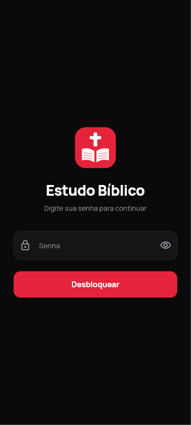 | 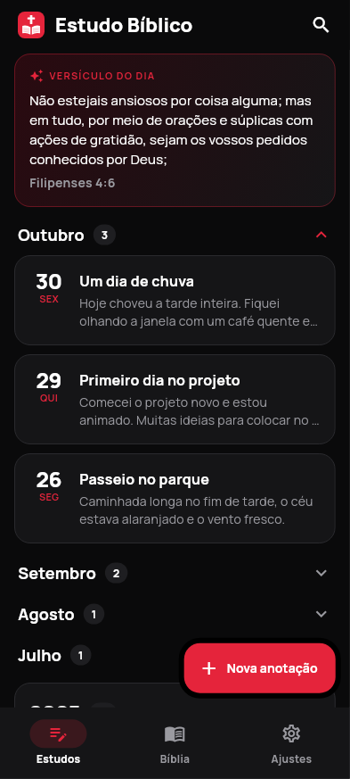 | 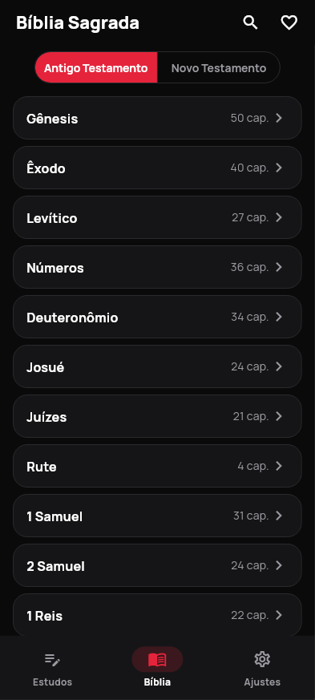 | 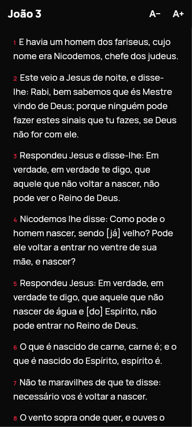 |


## Novidades desta versão

Esta atualização traz uma logo nova e três formas de trabalhar o versículo direto na leitura da Bíblia.

- **Logo nova.** O ícone antigo (cruz sobre a Bíblia, com fundo vermelho) foi trocado por uma imagem de uma Bíblia aberta de verdade, com páginas creme, fita dourada e fundo marrom quente, sem vermelho. Ela aparece no ícone do Android, no cabeçalho, na tela de bloqueio e em Ajustes › Sobre.
- **Seleção de versículos.** Um toque agora *seleciona* o versículo (e dá para marcar vários). Só então aparece o painel com as ações abaixo.
- **Marca-texto.** Grife o texto em amarelo, laranja, rosa ou azul. A cor fica salva e entra no backup cifrado. O ⊘ no painel remove o grifo.
- **Favoritar.** A opção que já existia continua no mesmo lugar, agora dentro desse painel (Favoritar / Desfavoritar). A lista de Favoritos não mudou.
- **Adicionar ao estudo.** Envia o trecho selecionado para um estudo já existente ou cria um estudo novo com ele. Se ainda não houver nenhum estudo, o app vai direto para a criação. Depois aparece o aviso *Trecho adicionado*, com o botão **Abrir**.
- **Copiar.** Copia o trecho com a referência.

| Logo (ícone) | Versículo selecionado | Grifos | Inserir no estudo |
|---|---|---|---|
| 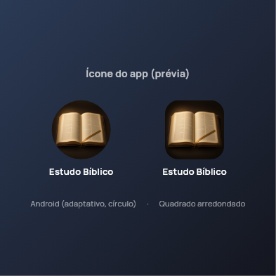 | 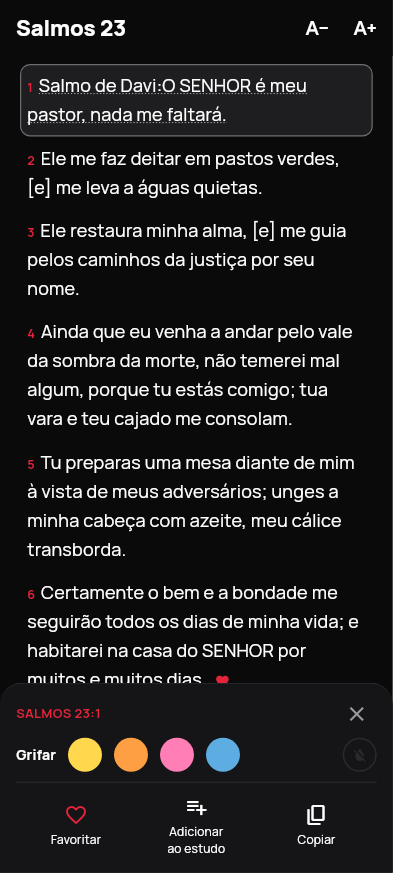 | 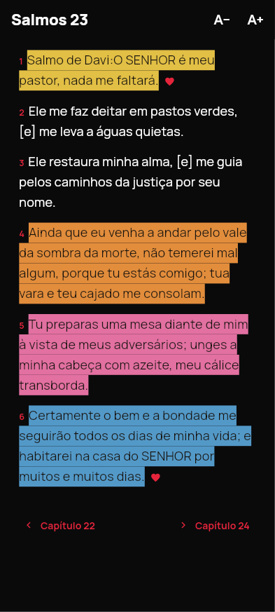 | 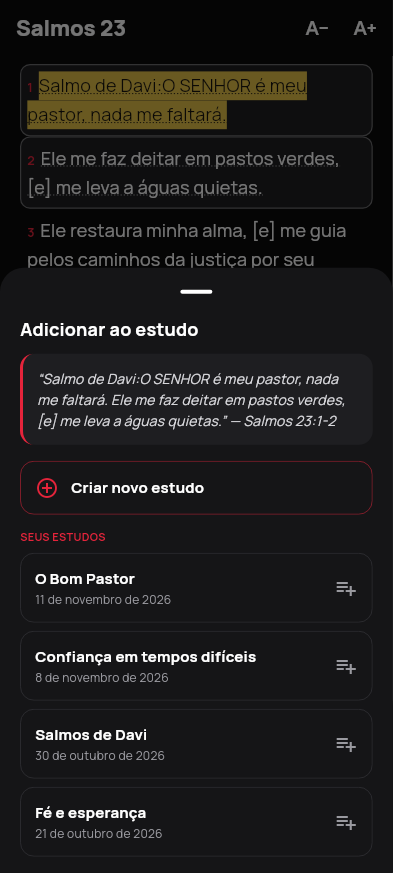 |

| Novo estudo | Trecho inserido |
|---|---|
| 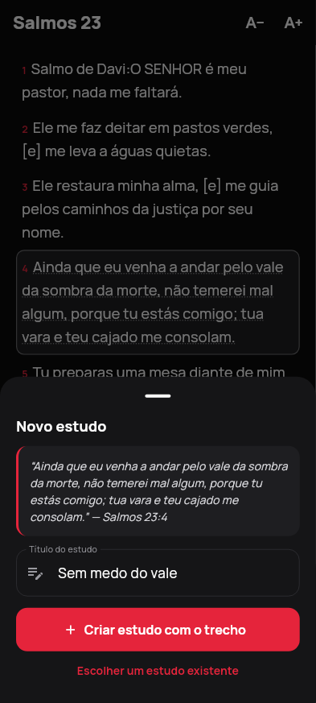 | 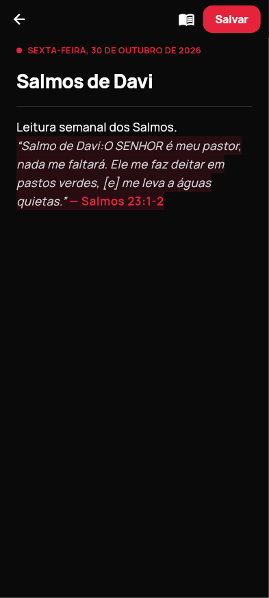 |

## Funcionalidades

- 🔒 **Senha local**: o app pede a senha sempre que é aberto ou volta do segundo plano.
- 📝 **Anotações de estudo**:
  - data do dia por extenso;
  - título e texto;
  - correção ortográfica do Android em português.
- 📖 **Bíblia Sagrada completa e offline** (Bíblia Livre):
  - Antigo e Novo Testamento;
  - grade de capítulos;
  - números dos versículos em vermelho;
  - tamanho de letra ajustável.
- 🔎 **Busca** por palavra em toda a Bíblia (ignora acentos e maiúsculas).
- ❤️ **Favoritos**: selecione um versículo e toque em *Favoritar*.
- 🖍️ **Marca-texto**: grife versículos em amarelo, laranja, rosa ou azul (fica salvo e vai no backup).
- 📌 **Adicionar ao estudo**: envie o trecho selecionado para um estudo existente ou crie um estudo novo com ele.
- ✨ **Versículo do dia** no topo da lista de anotações.
- ➕ **Inserir versículos na anotação**: busque por palavra ou referência, marque vários e toque em *Inserir*.
- 🗂️ **Organização automática**:
  - meses do ano atual;
  - anos anteriores agrupados (ano › meses › anotações), com contadores.
- ☁️ **Backup no Google Drive**:
  - automático ou manual, numa pasta oculta;
  - cifrado com AES-256-GCM e a sua senha;
  - também é possível exportar e importar uma cópia em arquivo.
- 🎨 Visual moderno em preto e branco, com ícone de uma Bíblia aberta em tons quentes.

## Como usar nos estudos

### 1. Criar a senha
Na primeira abertura, digite uma senha (mínimo 4 caracteres), confirme e toque em **Criar senha**.
Depois disso, o app sempre pede a senha para abrir. Para trocá-la: **Ajustes › Trocar senha**.

> ⚠️ Guarde bem a senha. Ela também protege os backups: sem ela não é possível restaurá-los.

### 2. Escrever uma anotação
Na aba **Estudos**, toque em **Nova anotação**:

- a data de hoje já aparece no topo (ex.: *Sexta-feira, 30 de outubro de 2026*);
- escreva um título (ex.: *João 3: o novo nascimento*) e o seu estudo;
- palavras com erro ficam sublinhadas em vermelho; toque nelas para ver as sugestões do teclado;
- toque em **Salvar**, ou simplesmente volte, que a anotação é salva.

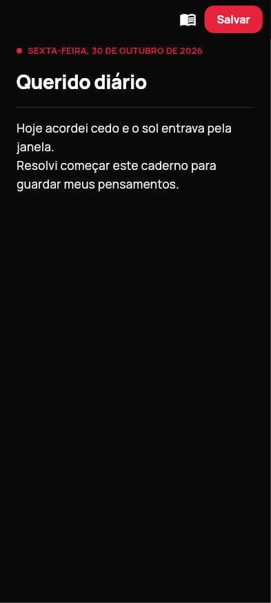

### 3. Inserir versículos dentro da anotação
No editor, toque no ícone de **Bíblia** 📖 (ao lado de *Salvar*). Abre um painel onde você pode:

- **navegar**: escolha o livro e depois o capítulo;
- **buscar por referência**, nome completo ou abreviado:

  | Você digita | Abre |
  |---|---|
  | `João 3:16` | João 3, com o versículo 16 marcado |
  | `Jo 3:16-18` | João 3, com os versículos 16 a 18 marcados |
  | `Sl 23` | Salmo 23 inteiro |
  | `1 Co 13:4` | 1 Coríntios 13, a partir do versículo 4 |
  | `Rm 8.28` | Romanos 8:28 |

- **buscar por palavra**, por exemplo `graça`, `pastor` ou `fé`.

Marque os versículos que quiser com as caixinhas; dá para juntar trechos de lugares diferentes. Depois toque em **Inserir**.
Eles entram no ponto onde está o cursor, como citação com a referência, e versículos seguidos viram um intervalo:

> “Porque Deus amou ao mundo de tal maneira… ” — João 3:16-17

| Seleção | Busca por palavra | Resultado na anotação |
|---|---|---|
| 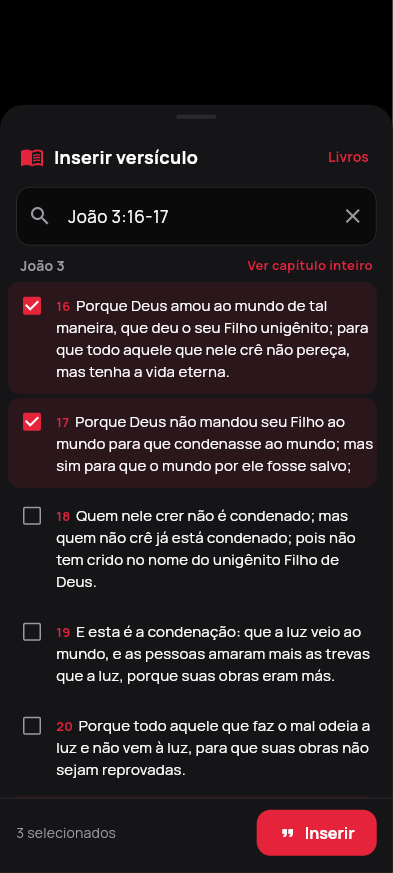 | 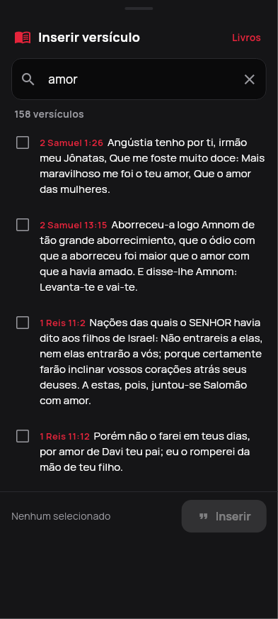 | 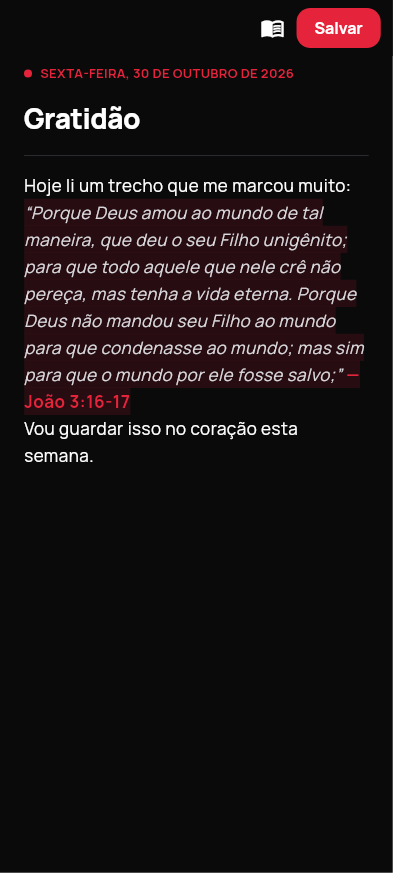 |

### 4. Ler, buscar e favoritar
Na aba **Bíblia**:

1. Escolha **Antigo** ou **Novo Testamento**, o livro e o capítulo.
2. Use **A− / A+** para ajustar o tamanho da letra (o app lembra a sua escolha).
3. Toque num versículo para **selecioná-lo** (toque em outros para selecionar vários). Aparece um painel com:
   - **Grifar**: escolha amarelo, laranja, rosa ou azul (o ⊘ remove o grifo);
   - **Favoritar** (♥). Veja todos em ❤️ **Favoritos**, no topo;
   - **Adicionar ao estudo**: abre a lista dos seus estudos; toque num deles para colocar o trecho no final, ou em **Criar novo estudo** para começar um estudo com ele;
   - **Copiar** o trecho com a referência.
4. Use 🔎 para **buscar** uma palavra ou frase. Tocar num resultado abre o capítulo com o versículo destacado.

| Capítulos | Busca | Favoritos |
|---|---|---|
| 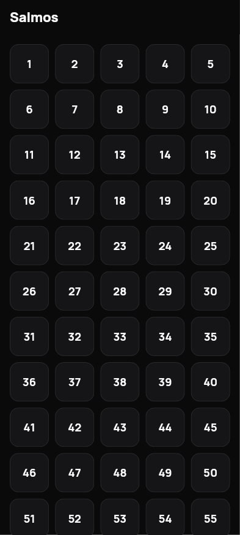 | 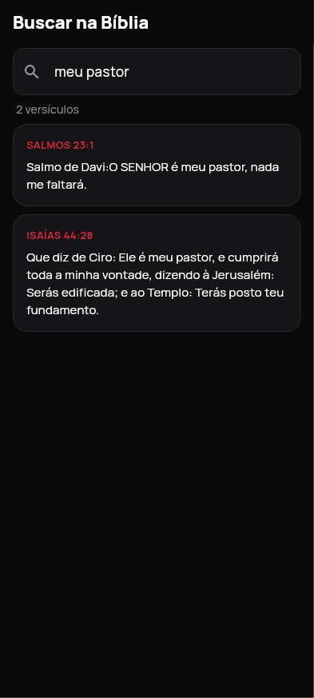 | 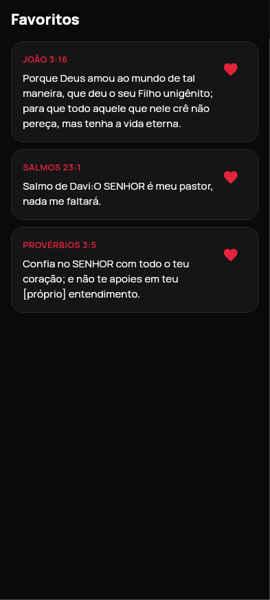 |

| Versículo selecionado | Grifos coloridos | Escolher o estudo | Novo estudo |
|---|---|---|---|
|  |  |  |  |

### 5. Versículo do dia
No topo da aba **Estudos** aparece um versículo diferente a cada dia. Toque nele para abrir o capítulo e começar o estudo por ali.

### 6. Encontrar anotações antigas
A lista se organiza sozinha:

- o **mês atual** fica aberto;
- os outros meses do ano ficam recolhidos;
- **anos anteriores** viram um cartão com o total de anotações; abra-o para ver os meses.

Use 🔎 para buscar no título e no texto. Para apagar, **arraste para a esquerda** ou **segure** a anotação; o app pede confirmação.

| Ano atual | Ano anterior aberto |
|---|---|
| 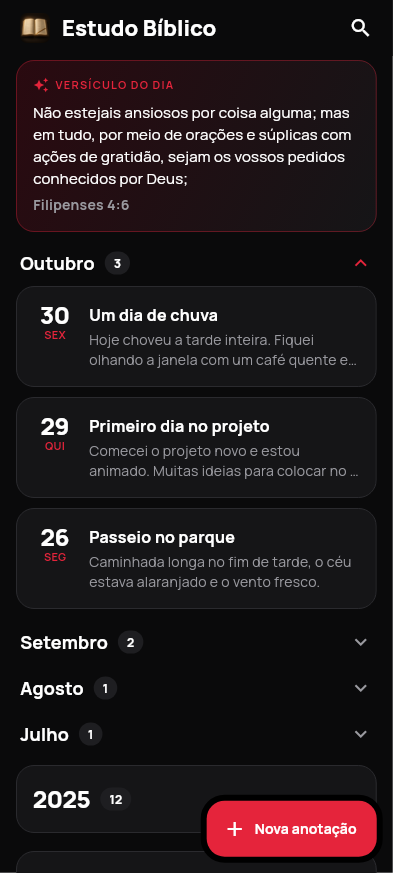 | 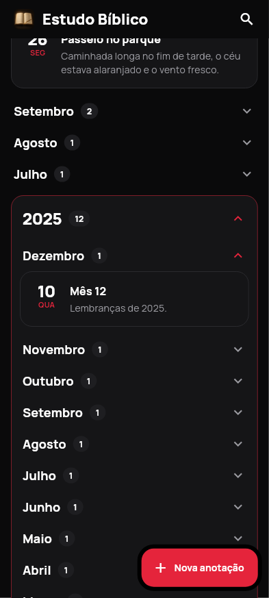 |

### 7. Backup e cópias
Em **Ajustes › Backup no Google Drive**:

- **Conectar**: entra com a sua conta Google (precisa da configuração descrita em [docs/GOOGLE_DRIVE.md](docs/GOOGLE_DRIVE.md)).
- **Backup automático**: faz o backup depois de salvar uma anotação e ao sair do app. Se estiver sem internet, tenta de novo na próxima vez.
- **Fazer backup agora** / **Restaurar do Drive**: o app pede confirmação e a senha usada no backup.
- **Exportar cópia (arquivo)** / **Importar cópia (arquivo)**: um arquivo `.mdb` cifrado que você pode guardar onde quiser. Funciona sem Google.

O backup inclui as anotações, os versículos favoritos e os grifos. A senha não vai no backup.

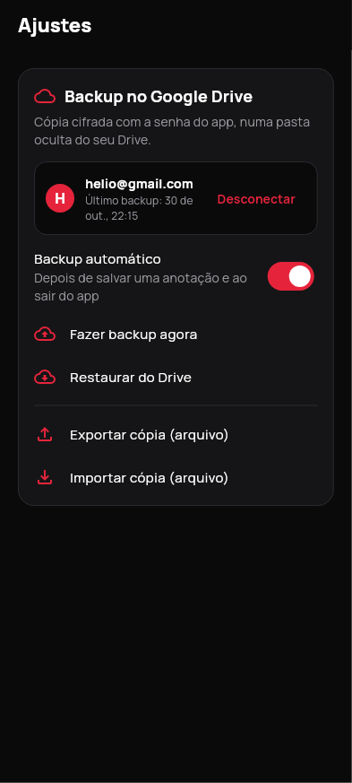

## Instalação (APK)

O APK de release fica na pasta [`releases/`](releases/) deste repositório:

- [`releases/EstudoBiblico.apk`](releases/EstudoBiblico.apk)

1. Baixe o arquivo no celular.
2. Abra-o e permita **instalar apps desta fonte** quando o Android pedir.
3. Abra o **Estudo Bíblico** e crie a sua senha (ou entre com a senha que já usa).

Quem já tinha a versão antiga ("Meu Diário") pode instalar por cima: o pacote é o mesmo (`com.helio.diario`) e os dados (anotações, favoritos, senha e backups) são mantidos. Esta versão de release é assinada com uma chave própria; a chave e as senhas **não** entram no repositório (ficam só em `android/key.properties` na máquina que gera o APK).

> Se o backup no Google Drive estiver configurado com o SHA-1 da chave de *debug*, cadastre também o SHA-1 da chave de *release* no Google Cloud. Veja [docs/GOOGLE_DRIVE.md](docs/GOOGLE_DRIVE.md).

## Como compilar

Requisitos: Flutter 3.x (Dart ≥ 3.8), JDK 17 e Android SDK.

```bash
flutter pub get
flutter analyze
flutter test                       # testes + capturas de tela (shots/)
flutter test --update-goldens      # regenera as capturas
flutter build apk --release --split-per-abi --target-platform android-arm64
# saída: build/app/outputs/flutter-apk/app-arm64-v8a-release.apk
```

O build de release usa a chave em `android/key.properties` (arquivo ignorado pelo git). Se esse arquivo não existir, o Gradle cai na chave de debug, só para desenvolvimento. Nenhuma chave ou senha é versionada neste repositório. O SHA-1 da chave de release precisa estar cadastrado no Google Cloud para o login do Drive funcionar no APK publicado (veja [docs/GOOGLE_DRIVE.md](docs/GOOGLE_DRIVE.md)).

### Estrutura

```
lib/
  main.dart            app, bloqueio e navegação (Estudos / Bíblia / Ajustes)
  theme.dart           design system (cores, tipografia, componentes, logo)
  data.dart            anotações (sqflite) e senha (hash SHA-256 com sal)
  bible.dart           Bíblia offline, busca, referências, favoritos
  backup.dart          backup cifrado, Google Drive e exportação
  store_scope.dart     acesso aos estudos a partir de qualquer tela
  screens/             telas: lock, list, editor, bible, add_to_study, verse_picker, settings
assets/
  biblia_livre.tsv.gz  texto bíblico completo (≈1,3 MB)
  logo.png             logo (Bíblia aberta) usada no app
  fonts/Manrope.ttf
docs/
  GOOGLE_DRIVE.md      configuração do login Google
  screenshots/
```

## Configuração do Google Drive

O app funciona normalmente sem ela; só o backup no Drive depende disso. O passo a passo (projeto no Google Cloud, Drive API, tela de consentimento e cliente Android com pacote e SHA-1) está em **[docs/GOOGLE_DRIVE.md](docs/GOOGLE_DRIVE.md)**.

## Créditos do texto bíblico

> Todas as Escrituras em português citadas são da Bíblia Livre (BLIVRE), Copyright © Diego Santos, Mario Sérgio, e Marco Teles, http://sites.google.com/site/biblialivre/ - fevereiro de 2018. Licença Creative Commons Atribuição 3.0 Brasil (http://creativecommons.org/licenses/by/3.0/br/). Reprodução permitida desde que devidamente mencionados fonte e autores.

Fonte: [github.com/blivre/BibliaLivre](https://github.com/blivre/BibliaLivre), release `2018.2.0` (`bliv-tr_vpl.zip`).
A fonte Manrope está sob a SIL Open Font License 1.1.

## Licença do código

© 2026 Hélio Rosado Neto. Ainda não foi escolhida uma licença de código aberto para o código-fonte, então todos os direitos estão reservados.
O texto bíblico incluído continua sob a licença CC BY 3.0 BR indicada acima.
